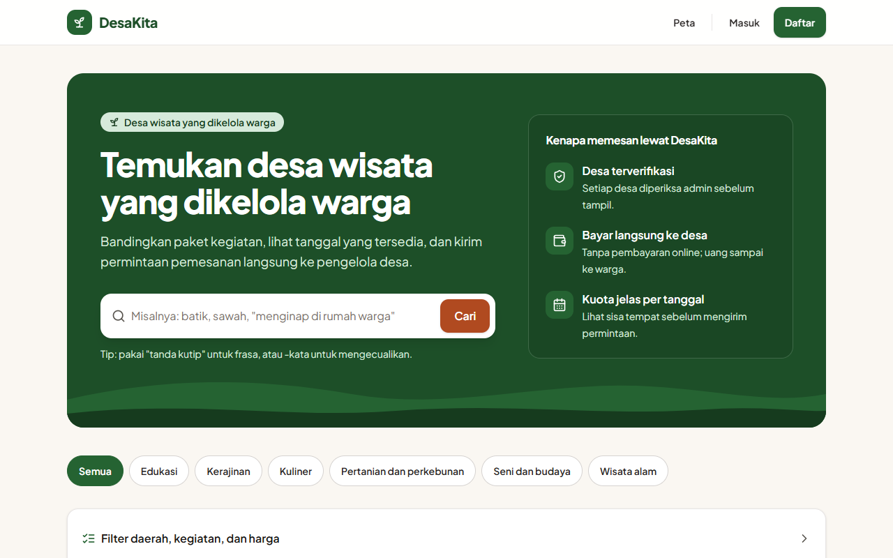
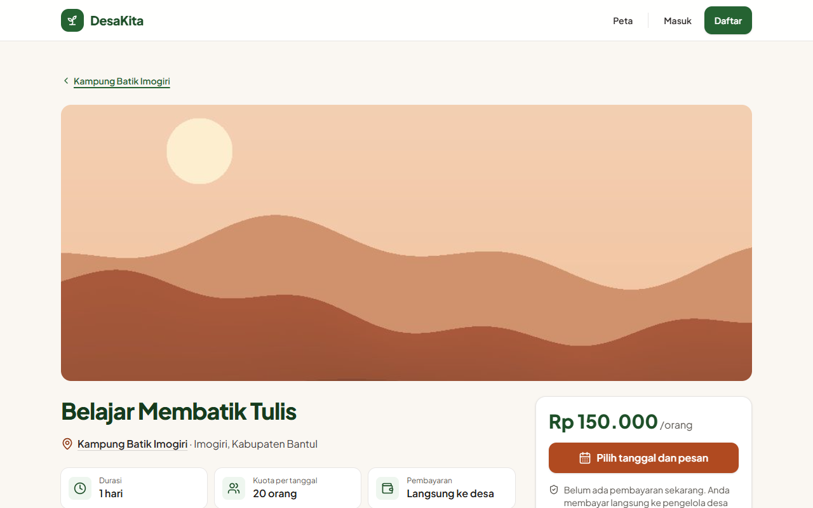
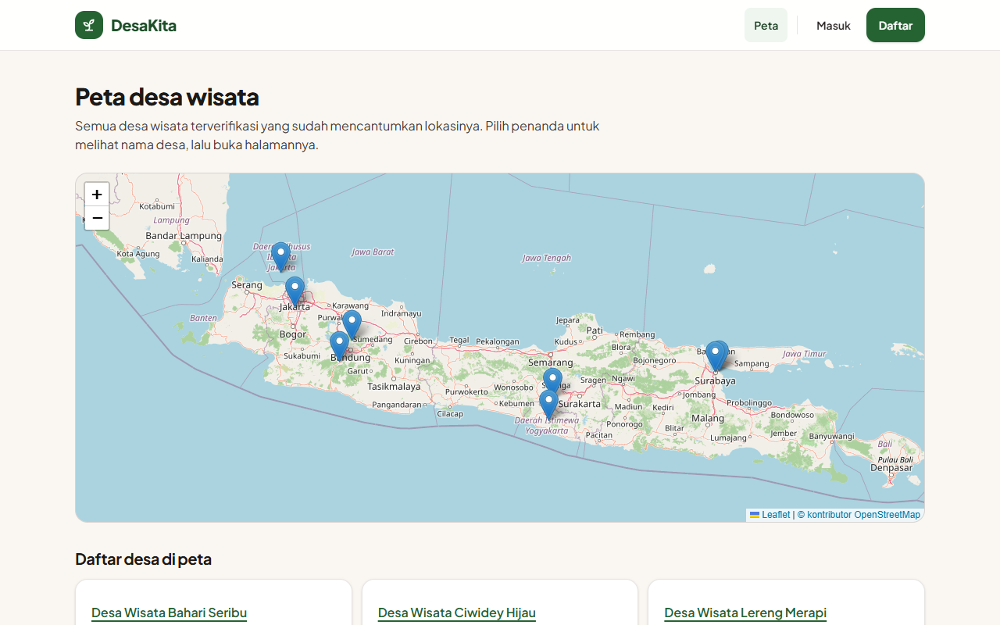
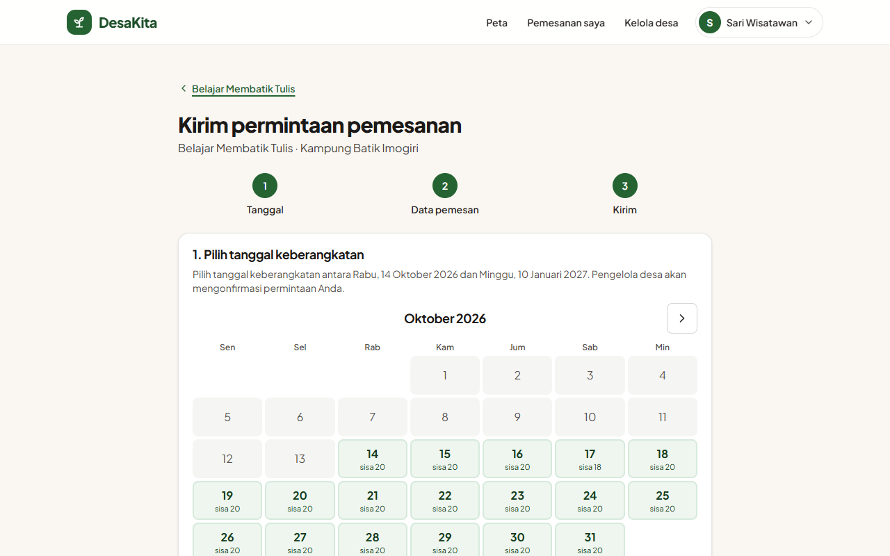
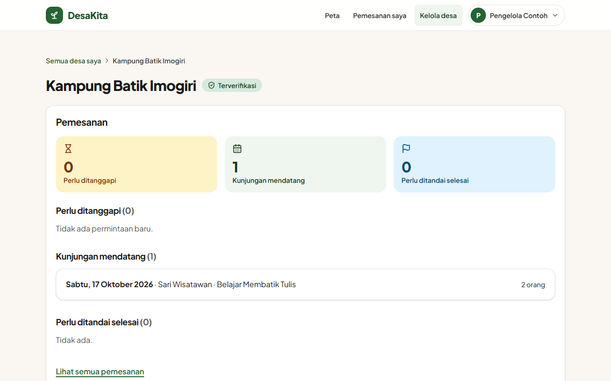
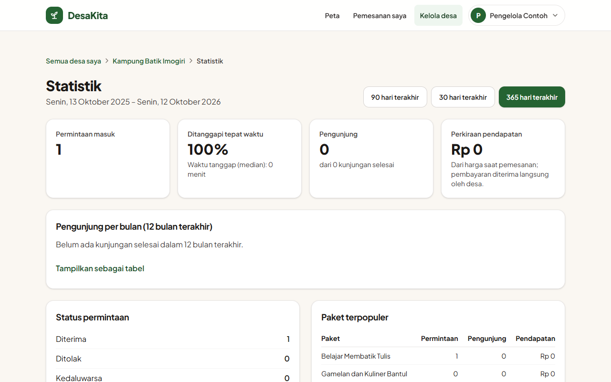
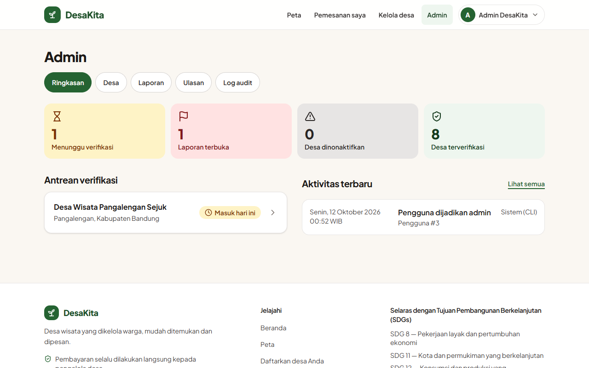
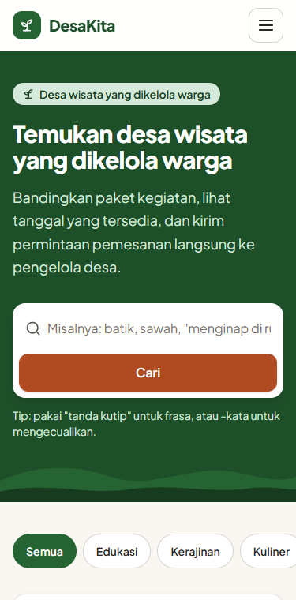

# DesaKita

**Website panduan dan pemesanan desa wisata yang dikelola warga.** Wisatawan mencari paket kegiatan, melihat tanggal yang masih tersedia, lalu mengirim permintaan pemesanan langsung ke pengelola desa. Pengelola mengatur profil desa, paket, kalender kuota, dan pemesanan dari dashboard sederhana. Admin memverifikasi desa dan menangani laporan.

Antarmuka tersedia dalam bahasa Indonesia dan Inggris. Proyek ini selaras dengan SDG 8 (pekerjaan layak), SDG 11 (permukiman berkelanjutan), dan SDG 12 (konsumsi bertanggung jawab).



| Halaman paket | Peta desa wisata |
|---|---|
|  |  |
| **Form pemesanan** | **Dashboard pengelola** |
|  |  |
| **Statistik pengelola** | **Dashboard admin** |
|  |  |

<details>
<summary>Tampilan di HP (375 px)</summary>

| Beranda | Paket | Pemesanan | Pengelola |
|---|---|---|---|
|  |  |  |  |

</details>

> Desa pada screenshot adalah **data contoh fiktif** dari perintah `seed-demo`.

---

## Daftar isi

- [Fitur](#fitur)
- [Teknologi](#teknologi)
- [Mulai cepat dengan Docker](#mulai-cepat-dengan-docker)
- [Menjalankan tanpa Docker](#menjalankan-tanpa-docker)
- [Akun admin](#akun-admin)
- [Data contoh](#data-contoh)
- [Konfigurasi](#konfigurasi)
- [Pengujian](#pengujian)
- [Mengunggah ke GitHub](#mengunggah-ke-github)
- [Deploy ke server](#deploy-ke-server)
- [Backup dan restore](#backup-dan-restore)
- [Struktur proyek](#struktur-proyek)
- [Berkontribusi](#berkontribusi)
- [Lisensi](#lisensi)

## Fitur

**Untuk wisatawan**
- Katalog paket dengan pencarian teks penuh (`"frasa"`, `-kata`), filter kabupaten/kota, jenis kegiatan, dan rentang harga, serta pengurutan. Katalog bisa dibuka tanpa login.
- Peta semua desa terverifikasi. Leaflet dan ubin petanya dilayani dari server sendiri.
- Kalender ketersediaan per tanggal keberangkatan, dengan sisa kuota yang terlihat.
- Permintaan pemesanan dengan status yang jelas: menunggu, dikonfirmasi, ditolak, dibatalkan, kedaluwarsa, dan selesai.
- Ulasan dan rating, hanya untuk kunjungan yang sudah selesai.
- Notifikasi email di setiap perubahan status.

**Untuk pengelola desa**
- Profil desa dengan lokasi di peta, foto (dengan persetujuan warga, dan metadata EXIF/GPS dihapus otomatis), serta paket wisata.
- Kalender kuota: ubah kuota atau tutup tanggal tertentu.
- Dashboard pemesanan: konfirmasi, tolak, batalkan, tandai selesai, dan tombol "Kabari via WhatsApp".
- Statistik: permintaan masuk, tingkat tanggapan, median waktu tanggap, pengunjung, perkiraan pendapatan, grafik bulanan, dan paket terpopuler.

**Untuk admin**
- Antrean verifikasi desa, penolakan, penonaktifan, dan pengaktifan kembali.
- Penanganan laporan pengguna dan moderasi ulasan.
- Log audit permanen untuk setiap tindakan admin.

**Kualitas dan keamanan**
- Kuota dijaga secara atomik di database, sehingga tidak bisa terjual melebihi batas walaupun banyak orang memesan bersamaan.
- Email memakai pola *transactional outbox*: email tidak hilang dan tidak terkirim ganda.
- CSP ketat (tanpa script atau style inline), CSRF, rate limit, password argon2id, dan cookie aman.
- Lolos axe-core WCAG 2.1 AA di 375 px dan 1280 px.
- Dua bahasa (Indonesia dan Inggris); email dikirim dalam bahasa penerima.

Pembayaran online **sengaja tidak dibuat**. Wisatawan membayar langsung kepada pengelola desa.

Spesifikasi lengkap, termasuk user story dan kriteria penerimaannya, ada di [docs/SPEC.md](docs/SPEC.md).

## Teknologi

| Bagian | Teknologi |
|---|---|
| Backend | Go 1.26, router [chi](https://github.com/go-chi/chi), sesi [scs](https://github.com/alexedwards/scs) |
| Database | PostgreSQL ≥ 14, [pgx](https://github.com/jackc/pgx), [sqlc](https://sqlc.dev) v1.29, [golang-migrate](https://github.com/golang-migrate/migrate) |
| Frontend | Go `html/template`, [htmx](https://htmx.org), [Tailwind CSS](https://tailwindcss.com) v4, [Leaflet](https://leafletjs.com) |
| Pengujian | `go test` (dengan PostgreSQL asli), [Playwright](https://playwright.dev) + [axe-core](https://github.com/dequelabs/axe-core) |
| Operasional | Docker, GitHub Actions, log JSON terstruktur, `/healthz` dan `/readyz` |

Template, CSS, JavaScript, dan migrasi tertanam di dalam satu binary, jadi produksi cukup menjalankan satu file atau satu image Docker.

## Mulai cepat dengan Docker

Prasyarat: [Docker Desktop](https://www.docker.com/products/docker-desktop/) atau Docker Engine dengan Compose.

```sh
git clone https://github.com/<akun-anda>/<nama-repo>.git
cd <nama-repo>
docker compose up --build
```

Buka **http://localhost:8080**. PostgreSQL ikut berjalan (di host pada port 5433), dan migrasi dijalankan otomatis saat aplikasi start.

Untuk mengisi data contoh dan membuat admin, jalankan perintah CLI di dalam container:

```sh
docker compose exec app desakita seed
docker compose exec -e APP_ENV=development app desakita seed-demo
docker compose exec app desakita promote-admin email@anda.id   # setelah mendaftar lewat web
```

## Menjalankan tanpa Docker

Prasyarat:
- [Go 1.26](https://go.dev/dl/)
- PostgreSQL ≥ 14 (misalnya bawaan Laragon, Postgres.app, atau paket sistem)
- [Node.js 22](https://nodejs.org), hanya jika Anda mengubah tampilan (membangun ulang CSS) atau menjalankan tes E2E

```sh
cp .env.example .env                    # lalu sesuaikan DATABASE_URL
createdb desakita                       # atau: psql -U postgres -c "CREATE DATABASE desakita"
go run ./cmd/desakita migrate up        # membuat tabel dan wilayah awal
go run ./cmd/desakita seed              # jenis kegiatan
go run ./cmd/desakita seed-demo         # opsional: desa contoh
go run ./cmd/desakita serve             # http://localhost:8080
```

File `.env` dibaca otomatis. File ini sudah masuk `.gitignore`, jadi tidak akan ikut ter-commit.

Perintah CLI yang tersedia:

| Perintah | Fungsi |
|---|---|
| `desakita serve` | menjalankan web server, worker email, dan job kedaluwarsa pemesanan |
| `desakita migrate up` / `migrate down 1` | menjalankan atau membatalkan migrasi |
| `desakita seed` | data dasar yang aman diulang (jenis kegiatan) |
| `desakita seed-demo` | 8 desa contoh di Bandung, Yogyakarta, Surabaya, dan Jakarta (khusus pengembangan) |
| `desakita promote-admin EMAIL` | menjadikan akun yang sudah terdaftar sebagai admin |

Jika mengubah template atau kelas CSS, bangun ulang CSS (hasilnya ikut di-commit):

```sh
npm install
npm run build:css
```

## Akun admin

Demi keamanan, tidak ada akun admin bawaan dan tidak ada tombol "jadikan admin" di web.

1. Daftar akun biasa di `/daftar`.
2. Jalankan `go run ./cmd/desakita promote-admin email@anda.id`, atau `docker compose exec app desakita promote-admin email@anda.id` di Docker.
3. Muat ulang halaman. Menu **Admin** akan muncul di header.

Pemberian hak admin ikut tercatat di log audit.

## Data contoh

`seed-demo` membuat 8 desa wisata **fiktif** yang sudah terverifikasi, dengan 13 paket, foto ilustrasi, dan titik di peta:

| Kota | Desa contoh |
|---|---|
| Bandung | Kampung Wisata Lembang Asri, Desa Wisata Ciwidey Hijau |
| Yogyakarta | Desa Wisata Lereng Merapi, Kampung Batik Imogiri |
| Surabaya | Kampung Heritage Bubutan, Kampung Nelayan Bulak Lestari |
| Jakarta | Kampung Budaya Betawi Jagakarsa, Desa Wisata Bahari Seribu |

Akun pengelola contoh: `pengelola.demo@desakita.local` dengan kata sandi `demo12345`. Perintah ini menolak berjalan jika `APP_ENV=production`.

## Konfigurasi

Semua konfigurasi dibaca dari variabel lingkungan atau file `.env`. Contohnya ada di [.env.example](.env.example).

| Variabel | Default | Keterangan |
|---|---|---|
| `DATABASE_URL` | — (wajib) | URL koneksi PostgreSQL |
| `APP_ENV` | `development` | `production` mengaktifkan cookie `Secure` dan HSTS |
| `HTTP_ADDR` | `:8080` | alamat server |
| `APP_BASE_URL` | `http://localhost:8080` | alamat publik, dipakai untuk tautan di email |
| `UPLOAD_DIR` | `./data/uploads` | folder foto (di Docker: volume `/data/uploads`) |
| `BOOKING_PENDING_TTL` | `48h` | batas waktu pengelola untuk menanggapi permintaan |
| `APP_TIMEZONE` | `Asia/Jakarta` | zona waktu tanggal bisnis |
| `LOG_LEVEL` | `info` | `debug`, `info`, `warn`, atau `error` |
| `TRUST_PROXY` | `false` | isi `true` hanya jika aplikasi berada di belakang reverse proxy yang menimpa `X-Forwarded-For` |
| `MAIL_FROM` | `DesaKita <noreply@desakita.local>` | pengirim email |
| `SMTP_HOST` | — | server SMTP; jika kosong, email ditulis sebagai file `.eml` ke `MAIL_DIR` |
| `SMTP_PORT` | `587` | port SMTP |
| `SMTP_USERNAME`, `SMTP_PASSWORD` | — | kredensial SMTP (AUTH PLAIN, hanya lewat TLS) |
| `SMTP_TLS` | `starttls` | `starttls` (wajib didukung server), `tls` (port 465), atau `none` (server lokal saja) |
| `MAIL_DIR` | `./data/mail` | folder `.eml` untuk pengembangan (di Docker: `/data/mail`) |
| `MAP_TILE_URL` | `https://tile.openstreetmap.org/{z}/{x}/{y}.png` | sumber ubin peta yang di-cache server; `off` = hanya ubin di `MAP_TILE_DIR` |
| `MAP_TILE_DIR` | `./data/tiles` | cache ubin peta (di Docker: `/data/tiles`) |
| `MAP_ATTRIBUTION`, `MAP_ATTRIBUTION_URL` | atribusi OpenStreetMap | wajib disesuaikan jika `MAP_TILE_URL` diganti |
| `TEST_DATABASE_URL` | — | server PostgreSQL untuk tes integrasi (user harus boleh `CREATEDB`) |

## Pengujian

```sh
bash scripts/check.sh                   # go vet + go test -race + govulncheck
npx playwright install chromium         # sekali saja, sebelum E2E pertama
npm run e2e                             # Playwright: alur utama, axe-core WCAG 2.1 AA, keyboard, menu HP
PW_CHANNEL=msedge npm run e2e           # sama, memakai Microsoft Edge yang terpasang
```

- **Tes integrasi** memakai PostgreSQL asli. Setiap paket tes mendapat database baru yang di-clone dari template hasil migrasi, jadi database pengembangan tidak pernah tersentuh. Set `TEST_DATABASE_URL`, misalnya `postgres://postgres@localhost:5432/postgres?sslmode=disable`.
- **Race detector** (`-race`) membutuhkan gcc. Di Windows, jalankan `scripts/check.sh` lewat WSL.
- **Tes E2E** dijalankan oleh `e2e/fixture`. Fixture ini membuat database `desakita_e2e`, mengisi data contoh, menjalankan aplikasi, dan memakai server ubin palsu, jadi tes tidak pernah menghubungi internet.
- **CI** (GitHub Actions, [.github/workflows/ci.yml](.github/workflows/ci.yml)) berjalan di setiap push ke `main` dan setiap pull request:
  - gofmt dan `sqlc diff`
  - vet, tes dengan race detector, dan govulncheck
  - aset front-end yang di-commit harus sama dengan hasil build
  - E2E dan aksesibilitas
  - build image Docker beserta smoke test `/readyz`

## Mengunggah ke GitHub

1. Buat repository baru (kosong, tanpa README) di https://github.com/new.
2. Dari folder proyek:

   ```sh
   git status                              # pastikan .env, data/, bin/ tidak ikut (sudah di .gitignore)
   git add -A
   git commit -m "DesaKita"
   git branch -M main
   git remote add origin https://github.com/<akun-anda>/<nama-repo>.git
   git push -u origin main
   ```

3. Buka tab **Actions** di GitHub. Workflow CI akan berjalan otomatis. Jika ingin badge status di README, tambahkan baris ini di bagian atas:

   ```markdown
   
   ```

Yang **tidak boleh** di-commit: `.env` (berisi kata sandi database dan SMTP), folder `data/` (foto, email, cache peta), dan file backup. Semuanya sudah diabaikan lewat `.gitignore`.

## Deploy ke server

GitHub hanya menyimpan kode. Agar website bisa diakses publik, aplikasi perlu dijalankan di server atau platform hosting yang punya PostgreSQL dan penyimpanan file permanen.

### Pilihan A: VPS dengan Docker Compose

Cocok untuk VPS mana pun (misalnya Ubuntu dengan Docker terpasang).

```sh
git clone https://github.com/<akun-anda>/<nama-repo>.git desakita
cd desakita
cat > .env <<'EOF'
APP_ENV=production
TRUST_PROXY=true
POSTGRES_PASSWORD=ganti-dengan-kata-sandi-panjang-acak
APP_BASE_URL=https://desakita.contoh.id
SMTP_HOST=smtp.penyedia-email.com
SMTP_USERNAME=...
SMTP_PASSWORD=...
MAIL_FROM=DesaKita <noreply@desakita.contoh.id>
EOF
docker compose up -d --build
```

Aplikasi berjalan di `127.0.0.1:8080` dan sengaja tidak terbuka langsung ke internet. Pasang reverse proxy dengan HTTPS di depannya. Contoh dengan [Caddy](https://caddyserver.com), yang mengurus sertifikat HTTPS otomatis:

```caddyfile
desakita.contoh.id {
    reverse_proxy 127.0.0.1:8080
}
```

`TRUST_PROXY=true` di `.env` membuat rate limit memakai IP asli pengunjung yang diteruskan proxy. Isi ini hanya jika aplikasi memang berada di belakang proxy. Setelah itu buat akun admin dengan `docker compose exec app desakita promote-admin email@anda.id`.

Untuk memperbarui ke versi terbaru:

```sh
git pull
docker compose up -d --build            # migrasi baru dijalankan otomatis saat start
```

### Pilihan B: platform hosting (Railway, Render, Fly.io, dan sejenisnya)

1. Hubungkan repository GitHub. Platform akan membangun image dari `Dockerfile`.
2. Tambahkan layanan PostgreSQL, lalu isi `DATABASE_URL`.
3. Set `APP_ENV=production`, `APP_BASE_URL`, `TRUST_PROXY=true`, dan variabel SMTP.
4. Pasang **volume permanen** di `/data`. Folder `/data/uploads`, `/data/mail`, dan `/data/tiles` menyimpan foto, email, dan cache peta. Tanpa volume, foto akan hilang setiap kali deploy.
5. Arahkan health check ke `/readyz`.
6. Jalankan **satu instance** saja, karena rate limit disimpan di memori.

### Daftar periksa produksi

- [ ] `APP_ENV=production` (cookie `Secure` dan HSTS aktif)
- [ ] HTTPS lewat reverse proxy, dan `TRUST_PROXY=true`
- [ ] `POSTGRES_PASSWORD` atau `DATABASE_URL` memakai kata sandi kuat
- [ ] `APP_BASE_URL` sesuai domain, dan `SMTP_*` terisi supaya email benar-benar terkirim
- [ ] Volume permanen untuk `/data` dan untuk data PostgreSQL
- [ ] Backup harian (lihat di bawah), dan restore pernah diuji
- [ ] Untuk trafik besar, `MAP_TILE_URL` diarahkan ke penyedia ubin selain server OpenStreetMap (yang hanya untuk penggunaan ringan)

### Endpoint dan log

- `GET /healthz`: liveness, tanpa mengecek database. Dipakai untuk `HEALTHCHECK` image.
- `GET /readyz`: readiness, melakukan ping ke database. Arahkan load balancer ke endpoint ini.
- Log ditulis sebagai satu baris JSON per request (method, path tanpa query string, status, durasi, `request_id`). Isi form, kata sandi, catatan pemesanan, nomor HP, dan alamat email tidak pernah dicatat.

## Backup dan restore

```sh
DATABASE_URL=... UPLOAD_DIR=/data/uploads BACKUP_DIR=/backups scripts/backup.sh
```

`backup.sh` melakukan langkah berikut:
1. membuat `pg_dump` (format custom) dan arsip foto;
2. memverifikasi dump;
3. menulis `SHA256SUMS`;
4. menghapus backup yang lebih tua dari `RETENTION_DAYS` (default 14 hari).

Jalankan setiap hari lewat cron, lalu salin hasilnya ke lokasi lain. File backup berisi data pribadi dan dibuat dengan izin 0600.

```sh
createdb desakita_restored
DATABASE_URL=postgres://.../desakita_restored UPLOAD_DIR=/data/uploads-restored \
  scripts/restore.sh /backups/desakita-20261011T020000Z --yes
```

`restore.sh` memeriksa checksum terlebih dahulu. Script ini menolak jalan tanpa `--yes` dan menolak database tujuan yang tidak kosong.

## Struktur proyek

```
cmd/desakita/        CLI: serve, migrate, seed, seed-demo, promote-admin
internal/
  app/               composition root: routing, middleware, adapter antarmodul, notifikasi
  auth/              akun, login, sesi, bahasa akun
  village/           desa, foto, lokasi, verifikasi
  tourpackage/       paket wisata dan pencarian
  booking/           pemesanan, kuota, kalender, statistik
  review/            ulasan dan moderasi
  admin/             dashboard admin dan laporan
  platform/          kode bersama (db, i18n, render, mail, tiles, httpx, ...)
  db/                kode hasil sqlc (jangan diedit)
migrations/          migrasi SQL (append-only)
queries/             query sqlc
web/
  templates/         layout, halaman, partial
  locales/           teks UI: id.json, en.json
  emails/            template email per bahasa
  static/            CSS hasil build, JS, font, Leaflet
  assets/            sumber Tailwind CSS
e2e/                 tes Playwright dan fixture Go
scripts/             check, backup, restore, vendor aset
docs/                SPEC.md dan screenshot
```

## Berkontribusi

- Baca [docs/SPEC.md](docs/SPEC.md) sebelum mengubah perilaku aplikasi, dan [CLAUDE.md](CLAUDE.md) untuk aturan arsitektur (arah dependensi antarmodul, aturan kuota, CSP, dan i18n).
- Setiap teks UI ditulis lewat kunci i18n, di `web/locales/id.json` **dan** `en.json`.
- Migrasi bersifat append-only: tambahkan pasangan file bernomor baru, jangan mengubah migrasi lama.
- Sebelum commit, jalankan `bash scripts/check.sh`, lalu `npm run e2e` jika tampilan berubah.

## Lisensi

Lisensi untuk kode proyek ini **belum ditentukan**. Tanpa file `LICENSE`, repository publik di GitHub secara hukum berarti "semua hak dilindungi": orang lain boleh melihat kodenya, tetapi tidak boleh memakai atau mengubahnya. Tambahkan file `LICENSE` (misalnya MIT atau Apache-2.0) jika ingin mengizinkan penggunaan ulang.

Komponen pihak ketiga yang ikut didistribusikan:
- Font Plus Jakarta Sans: SIL Open Font License 1.1 ([web/static/fonts/OFL.txt](web/static/fonts/OFL.txt))
- Ikon Lucide: lisensi ISC (teksnya ada di header `web/templates/partials/icons.html`)
- Leaflet: BSD-2-Clause ([web/static/leaflet/LICENSE.txt](web/static/leaflet/LICENSE.txt))
- htmx: BSD Zero Clause
- Data peta: © kontributor [OpenStreetMap](https://www.openstreetmap.org/copyright) (ODbL)
