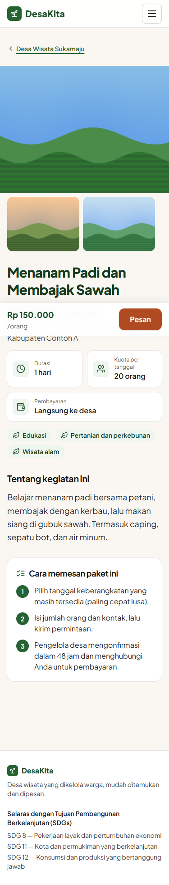
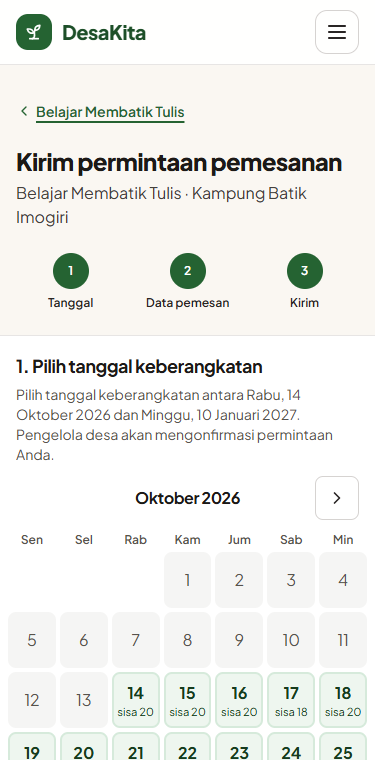
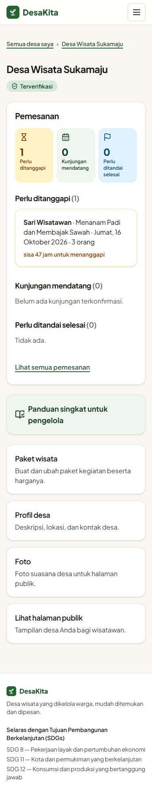

# DesaKita

Website panduan dan pemesanan desa wisata. Setiap desa punya halaman profil, paket kegiatan, kalender ketersediaan, dan permintaan pemesanan. Pengelola desa mengatur semuanya lewat dashboard sederhana. Proyek ini selaras dengan SDG 8, 11, dan 12.

Spesifikasi lengkap, termasuk user story dan kriteria penerimaannya, ada di [docs/SPEC.md](docs/SPEC.md).

| Halaman paket (HP) | Form pemesanan (HP) | Dashboard pengelola (HP) |
|---|---|---|
|  |  |  |

Screenshot lain (lebar 320, 375, dan 1280 px) ada di [docs/screenshots/](docs/screenshots/).

## Fitur MVP

- Katalog dan pencarian dengan filter kabupaten, jenis kegiatan, harga, dan kata kunci. Katalog bisa dibuka tanpa login.
- Profil desa dan paket wisata. Setiap foto diunggah dengan persetujuan warga, dan metadata lokasinya (EXIF/GPS) dihapus.
- Kalender ketersediaan per tanggal keberangkatan, serta permintaan pemesanan dengan status menunggu, dikonfirmasi, ditolak, dibatalkan, kedaluwarsa, dan selesai.
- Kuota dijaga secara atomik di database, sehingga tidak bisa terjual melebihi batas walaupun banyak orang memesan bersamaan.
- Dashboard pengelola dan tombol "Kabari via WhatsApp".
- Admin: verifikasi desa, penonaktifan desa, dan penanganan laporan pengguna.
- Pembayaran online sengaja tidak dibuat. Pembayaran diatur langsung antara wisatawan dan pengelola.

## Teknologi

Go 1.26 dengan router chi · PostgreSQL ≥ 14 (sqlc + pgx, golang-migrate) · Go `html/template` + HTMX + Tailwind CSS v4 · session cookie dengan argon2id · Playwright + axe-core untuk tes end-to-end dan aksesibilitas.

## Menjalankan secara lokal

Prasyarat: Go 1.26, PostgreSQL ≥ 14, dan Node.js 22 (Node hanya diperlukan untuk membangun CSS atau menjalankan tes E2E).

```sh
cp .env.example .env                    # sesuaikan DATABASE_URL
createdb desakita
go run ./cmd/desakita migrate up
go run ./cmd/desakita seed              # jenis kegiatan + wilayah contoh
go run ./cmd/desakita serve             # http://localhost:8080
```

Setelah mendaftar lewat web, jadikan akun Anda admin:

```sh
go run ./cmd/desakita promote-admin email@anda.id
```

Cara lain, dengan Docker:

```sh
docker compose up --build               # aplikasi di http://localhost:8080, PostgreSQL di port 5433
```

## Konfigurasi (variabel lingkungan)

| Variabel | Default | Keterangan |
|---|---|---|
| `DATABASE_URL` | — (wajib) | URL koneksi PostgreSQL |
| `APP_ENV` | `development` | `production` mengaktifkan cookie `Secure` dan HSTS |
| `HTTP_ADDR` | `:8080` | alamat server |
| `UPLOAD_DIR` | `./data/uploads` | folder foto (di Docker: volume `/data/uploads`) |
| `BOOKING_PENDING_TTL` | `48h` | batas waktu pengelola untuk menanggapi permintaan |
| `APP_TIMEZONE` | `Asia/Jakarta` | zona waktu tanggal bisnis |
| `LOG_LEVEL` | `info` | `debug`, `info`, `warn`, atau `error` |
| `TRUST_PROXY` | `false` | isi `true` hanya jika aplikasi berada di belakang reverse proxy yang menimpa `X-Forwarded-For` |
| `APP_BASE_URL` | `http://localhost:8080` | alamat publik untuk tautan di email |
| `MAIL_FROM` | `DesaKita <noreply@desakita.local>` | pengirim email |
| `SMTP_HOST` | — | server SMTP; jika kosong, email ditulis sebagai file `.eml` ke `MAIL_DIR` |
| `SMTP_PORT` | `587` | port SMTP |
| `SMTP_USERNAME`, `SMTP_PASSWORD` | — | kredensial SMTP (AUTH PLAIN, hanya lewat TLS) |
| `SMTP_TLS` | `starttls` | `starttls` (wajib tersedia), `tls` (port 465), atau `none` (server lokal saja) |
| `MAIL_DIR` | `./data/mail` | folder `.eml` untuk pengembangan (di Docker: `/data/mail`) |
| `MAP_TILE_URL` | `https://tile.openstreetmap.org/{z}/{x}/{y}.png` | sumber ubin peta yang di-cache server; `off` = hanya ubin di `MAP_TILE_DIR` |
| `MAP_TILE_DIR` | `./data/tiles` | cache ubin peta (di Docker: `/data/tiles`) |
| `MAP_ATTRIBUTION`, `MAP_ATTRIBUTION_URL` | atribusi OpenStreetMap | wajib disesuaikan jika `MAP_TILE_URL` diganti |

## Pengujian

```sh
bash scripts/check.sh                   # go vet, go test -race, govulncheck (butuh TEST_DATABASE_URL dan gcc)
PW_CHANNEL=msedge npm run e2e           # Playwright: alur utama, axe-core WCAG 2.1 AA, keyboard, menu HP
```

- **Tes integrasi** memakai PostgreSQL asli. Setiap paket tes mendapat database baru yang di-clone dari template hasil migrasi. `TEST_DATABASE_URL` harus menunjuk ke server dengan user yang boleh `CREATEDB`.
- **Tes konkurensi kuota** ada di `internal/booking`.
- **Tes E2E** dijalankan oleh `e2e/fixture`, yang membuat database `desakita_e2e` berisi data contoh lalu menjalankan aplikasi. Di CI dipakai Chromium; secara lokal, `PW_CHANNEL` bisa diisi `msedge` atau `chrome`.
- **CI** (GitHub Actions, [.github/workflows/ci.yml](.github/workflows/ci.yml)):
  - gofmt dan `sqlc diff`
  - vet, tes dengan race detector, dan govulncheck
  - aset front-end yang di-commit harus sesuai hasil build
  - E2E dan aksesibilitas
  - build image Docker beserta smoke test `/readyz`

## Deployment

- **Image:** build dari `Dockerfile`. Image berisi binary statis (template, aset, dan migrasi sudah tertanam), berjalan sebagai user non-root, dan menjalankan migrasi saat start.
- **Endpoint kesehatan:**
  - `GET /healthz`: liveness, tanpa mengecek database. Dipakai untuk `HEALTHCHECK` image.
  - `GET /readyz`: readiness, melakukan ping ke database. Arahkan load balancer ke endpoint ini.
- **Log:** satu baris JSON per request (method, path tanpa query string, status, durasi, `request_id`). Isi form, kata sandi, catatan pemesanan, dan nomor HP tidak pernah dicatat.
- **HTTPS:** pasang reverse proxy (Caddy, nginx, atau proxy platform), lalu set `APP_ENV=production` dan `TRUST_PROXY=true`.
- **Email:** notifikasi masuk antrean `email_outbox` dalam transaksi yang sama dengan perubahannya, lalu dikirim oleh worker di dalam `serve` (lihat SPEC §13). Isi `SMTP_HOST` dan `APP_BASE_URL` di production.
- **Peta:** ubin peta diambil server dari `MAP_TILE_URL` lalu di-cache di `MAP_TILE_DIR` (lihat SPEC §14). Server ubin OpenStreetMap hanya untuk trafik ringan, jadi gunakan penyedia ubin lain untuk trafik besar.
- **Batasan:** rate limit disimpan di memori, jadi jalankan satu instance aplikasi.

## Backup dan restore

```sh
DATABASE_URL=... UPLOAD_DIR=/data/uploads BACKUP_DIR=/backups scripts/backup.sh
```

`backup.sh` membuat `pg_dump` (format custom) dan arsip foto, memverifikasi dump, menulis `SHA256SUMS`, lalu menghapus backup yang lebih tua dari `RETENTION_DAYS` (default 14 hari). Jalankan setiap hari lewat cron, lalu salin hasilnya ke lokasi lain. File backup berisi data pribadi dan dibuat dengan izin 0600.

```sh
createdb desakita_restored
DATABASE_URL=postgres://.../desakita_restored UPLOAD_DIR=/data/uploads-restored \
  scripts/restore.sh /backups/desakita-20261011T020000Z --yes
```

`restore.sh` memeriksa checksum terlebih dahulu. Script ini menolak jalan tanpa `--yes` dan menolak database tujuan yang tidak kosong. Uji proses restore secara berkala.

## Struktur

```
cmd/desakita/      CLI: serve, migrate, seed, promote-admin
internal/          modul domain (auth, village, tourpackage, booking, admin) + platform
migrations/        migrasi SQL (append-only)      queries/   query sqlc
web/               template, teks UI (id.json), aset statis
e2e/               tes Playwright + fixture Go     scripts/   check, backup, restore
```

Aturan arsitektur untuk kontributor ada di [CLAUDE.md](CLAUDE.md).

## Lisensi pihak ketiga

- Font Plus Jakarta Sans: SIL Open Font License 1.1 ([web/static/fonts/OFL.txt](web/static/fonts/OFL.txt)).
- Ikon Lucide: lisensi ISC (teks lisensinya ada di header `web/templates/partials/icons.html`).
- htmx: lisensi BSD Zero Clause.

Lisensi untuk kode proyek ini sendiri belum ditentukan.
